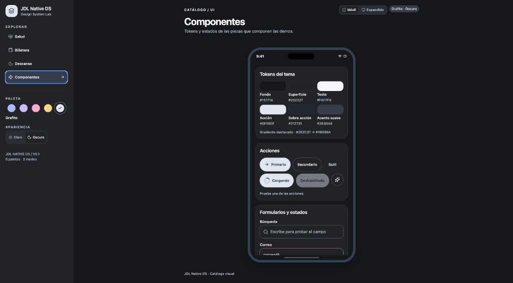

# JDL Native DS

Sistema de diseño agnóstico y de alto rendimiento para **React Native** y **TypeScript**.

<p align="center">
  
</p>

El repositorio contiene:
* **`@jhohellsdl/native-ds`**: Paquete de componentes y tokens de UI puro, compilado a JavaScript estándar (`dist/`) con tipado estricto `.d.ts`. Cero dependencia de Expo.
* **Laboratorio interactivo (Vite + React Native Web)**: Entorno ultraligero que inicia en menos de un segundo para previsualizar componentes, demos y tokens en tiempo real, incluyendo un simulador interactivo de dispositivo móvil de 390px.
* **Suite de contrastes y accesibilidad**: Pruebas automáticas de ratio de contraste WCAG para los diez temas (5 paletas × 2 modos).

---

## 🚀 Arranque rápido del laboratorio

Usa Node.js 22 LTS o superior y pnpm. Desde la raíz del repositorio:

```bash
pnpm install
pnpm dev
```

Abre automáticamente en `http://localhost:5173`. Podrás explorar el catálogo de componentes y las pantallas interactivas de demostración (Salud, Billetera, Descanso) con cambio dinámico de tema, modo (Claro / Oscuro) y alternancia entre vista móvil y expandida.

| Comando | Acción |
| --- | --- |
| `pnpm dev` / `pnpm start` | Inicia el laboratorio web con recarga instantánea (< 1s) |
| `pnpm build` | Compila la librería `@jhohellsdl/native-ds` a `packages/ui/dist` |
| `pnpm pack:ui` | Empaqueta la librería en un tarball comprimido `.tgz` listo para distribución |
| `pnpm build:lab` | Genera el bundle de producción web del laboratorio en `dist/` |
| `pnpm check:themes` | Ejecuta la suite de verificación de contrastes en terminal |
| `pnpm typecheck` | Comprueba tipos con TypeScript en todo el monorepo |

---

## 📱 Simulador de Dispositivo Móvil en el Laboratorio

El laboratorio incluye un visor con mockup móvil integrado que emula la experiencia visual en un dispositivo real:
* **Viewport estándar móvil (390px)**: Ancho de pantalla moderno con esquinas redondeadas, barra de estado simulada (9:41, señal, Wi-Fi, batería) y Dynamic Island.
* **Scroll desacoplado e indicador de inicio**: Scrollview contenido con barra de desplazamiento oculta y barra inferior (*Home Indicator*).
* **Toggle Móvil / Expandido**: Permite alternar en cualquier momento entre el frame móvil y la vista expandida de escritorio.
* **`MobileViewContext`**: Contexto que notifica automáticamente a los componentes cuando están dentro del contenedor móvil para adaptar sus variantes y densidades a pantallas pequeñas.

---

## 🎨 Fundaciones y Tokens de Diseño

La librería expone un sistema completo de tokens escalables para aplicaciones móviles y diseño responsivo:

### Spacing
Escala armónica de espaciado:
`xxs: 2`, `xs: 4`, `sm: 8`, `md: 12`, `lg: 16`, `xl: 24`, `xxl: 32`, `3xl: 48`, `4xl: 64`.

### Radius
Curvaturas consistentes para esquinas de contenedores y controles:
`none: 0`, `xs: 4`, `sm: 8`, `md: 12`, `control: 14`, `card: 22`, `pill: 999`.

### Sizes
Dimensiones táctiles e iconografía basadas en estándares de accesibilidad:
* **`touchTarget`**: `44px` (área mínima táctil según WCAG y Apple HIG).
* **`icon`**: `xs: 14`, `sm: 18`, `md: 22`, `lg: 28`, `xl: 40`, `hero: 56`.
* **`control`**: `sm: 36`, `md: 44`, `lg: 52`.

### Layout
Pautas estructurales y de cuadrícula:
* **`gutter`**: `compact: 16`, `regular: 24`, `expanded: 32`.
* **`maxWidth`**: `content: 850`, `modal: 480`, `card: 380`.
* **`breakpoints`**: `compact: 600`, `desktop: 900`.

### Paletas y Modos
5 paletas armónicas con contraste accesible garantizado:
* **Cobalt**: Azul tecnológico y confiable.
* **Iris**: Violeta e índigo elegante.
* **Rose**: Tonos cálidos y vibrantes.
* **Amber**: Acentos enérgicos y dorados.
* **Graphite**: Monocromático sobrio y minimalista.

Cada paleta implementa automáticamente los modos `light` y `dark` validados mediante pruebas automatizadas de ratio WCAG.

---

## 📦 Cómo usar la librería en tu aplicación

El paquete `@jhohellsdl/native-ds` es **100% agnóstico**: funciona en proyectos de **React Native CLI (Bare)**, **Expo**, **Next.js** o **React Native Web**.

### 1. Empaquetar o instalar

Para generar un tarball local desde el monorepo:

```bash
pnpm pack:ui
```

En la aplicación cliente:

```bash
# Instalación directa desde GitHub Packages:
pnpm add @jhohellsdl/native-ds

# O mediante tarball local:
pnpm add /ruta/a/jhohellsdl-native-ds-0.1.0.tgz
```

### 2. Implementación

Envuelve la aplicación con `ThemeProvider`:

```tsx
import React from 'react';
import { ThemeProvider, Button, Card, Text } from '@jhohellsdl/native-ds';

export default function App() {
  return (
    <ThemeProvider palette="graphite" mode="dark">
      <Card tone="surface">
        <Text variant="title">Bienvenido a JDL Native DS</Text>
        <Button label="Comenzar" onPress={() => console.log('Presionado')} />
      </Card>
    </ThemeProvider>
  );
}
```

---

## 🏗️ Estructura del repositorio

```text
jdl-native-ds/
├── assets/                     # Recursos visuales y capturas de documentación
│   └── lab-preview.png         # Captura del laboratorio en modo móvil
├── packages/
│   └── ui/                     # Librería @jhohellsdl/native-ds
│       ├── dist/               # Salida compilada (JS plano + .d.ts) para React Native CLI
│       ├── src/                # Código fuente (TypeScript)
│       │   ├── theme.ts        # Paletas, tokens (spacing, radius, sizes, layout) y tipografía
│       │   ├── ThemeProvider.tsx # Contexto y hook useTheme()
│       │   ├── Buttons.tsx     # Button, IconButton
│       │   ├── Surfaces.tsx    # Card, Badge, MetricCard
│       │   ├── Text.tsx        # Tipografía con roles semánticos
│       │   └── TextField.tsx   # Input de texto con validación y estados
│       └── tsconfig.json       # Configuración de compilación del paquete
├── src/                        # Laboratorio interactivo (React Native Web)
│   ├── App.tsx                 # Shell del laboratorio, visor móvil y ErrorBoundary
│   ├── ComponentCatalog.tsx    # Catálogo visual de tokens y componentes
│   ├── ThemeControls.tsx       # Controles dinámicos de paleta y apariencia (claro/oscuro)
│   ├── screens.tsx             # Pantallas de demostración (Salud, Billetera, Descanso)
│   └── shims/                  # Shims de compatibilidad navegador/web
├── checks/                     # Pruebas de contraste y accesibilidad WCAG
├── index.html                  # Entry point HTML con visor de diagnóstico de errores
└── vite.config.ts              # Configuración de Vite con aliases de React Native Web y SVG
```

---

## 🌐 Compatibilidad Web & Laboratorio

El laboratorio corre sobre **Vite** mapeando primitivas de React Native a la web mediante **React Native Web**:
* **Resolución SVG**: Mapeo transparente de `react-native-svg` a su implementación web nativa (`ReactNativeSVG.web.js`) para compatibilidad directa con iconos (`lucide-react-native`) y gradientes SVG.
* **Seguridad y Diagnóstico**: Integración de `ErrorBoundary` en React y capturadores globales en `index.html` para diagnóstico inmediato de errores en runtime sin pantallas en blanco silenciosas.
* **Optimización de dependencias**: Configuración de `optimizeDeps` con extensiones de plataforma (`.web.tsx`, `.web.ts`, `.web.js`) para recargas instantáneas.
